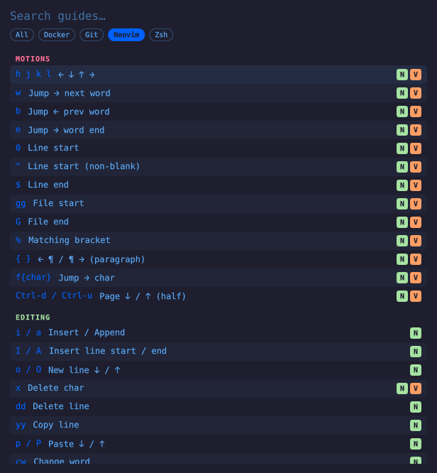
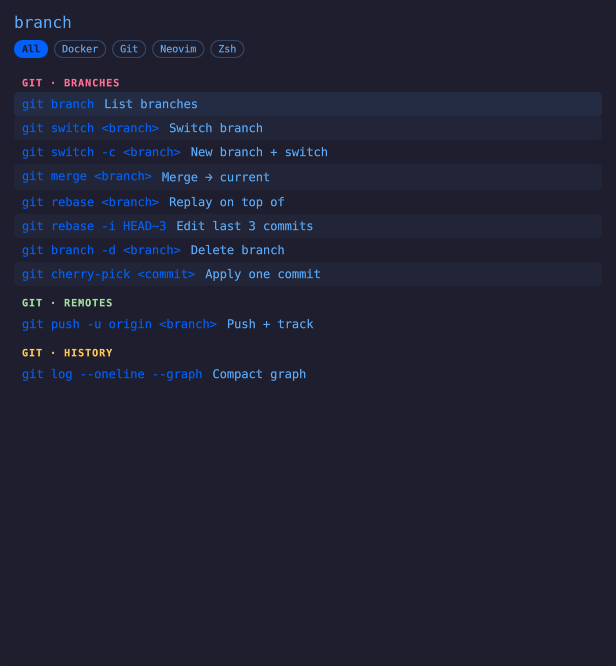

# Omarchy-QRG — Quick Reference Guide for Omarchy

A bar button for [Omarchy](https://omarchy.org) that opens a searchable cheat-sheet panel. Ships with guides for **Neovim, Docker, Zsh and Git**, and you can add your own as plain text files.

- Type to filter across all guides, **Tab** / **Shift-Tab** to switch guide, **↑ / ↓** to move, **Enter** (or click) to copy the keys/command, **Esc** to clear / close.
- Hover a row for its example.
- Colors follow your Omarchy theme.

<p align="center">
  
  
</p>

## Install

```sh
omarchy plugin add https://github.com/jcmarinn/Omarchy-QRG.git --enable
omarchy-restart-shell
```

Open it from the new book icon in the bar, or bind a key to `omarchy-shell qrg toggle`. Requires `wl-copy` (`wl-clipboard`, included with Omarchy). Update with `omarchy plugin update jcmarin.qrg`.

## Add your own guide

Run:

```sh
omarchy-shell qrg newGuide tmux
```

That creates `~/.config/qrg/guides/tmux.txt` from a template and opens it in your editor. Guides are plain text — one file per tool, the file name is the guide's id:

```
# Tmux
Terminal multiplexer

## Sessions
tmux new -s <name>      | New session
tmux attach -t <name>   | Attach           | tmux a -t work works too | #session

## Panes
[N] Ctrl-b %            | Split │
```

| Part | Meaning |
|------|---------|
| `# Name` | Guide title (optional; defaults to the file name) |
| line after the title | One-line description (optional) |
| `## Title` | Starts a section |
| `keys \| description` | An entry — both required |
| third field | Example, shown in the hover tooltip |
| `#word #word` | Search tags (as the last field) |
| `[N V]` before the keys | Mode badges for modal tools (`N` `I` `V` `C`) |
| `// text` | Comment |

Save the file and reopen the panel — no restart or build step. If a line is malformed, the panel shows a warning with the file and line number and skips just that line.

A file in `~/.config/qrg/guides/` with the same name as a bundled guide (say `git.txt`) **replaces** it, so you can customise the built-ins too. Your guides are outside the plugin folder, so `omarchy plugin update` never touches them.

Want a guide included for everyone? Open a pull request adding it to `guides/`.

## Development

```sh
node --test tests/parser.test.mjs     # parser + search tests
omarchy plugin validate .             # manifest check
```

If you symlink a working copy into `~/.config/omarchy/plugins/jcmarin.qrg`, QML edits are not hot-reloaded — run `omarchy-restart-shell`.

There is also a web version of the same guides: [QRG-web](https://github.com/jcmarinn/QRG-web).

## License

[MIT](LICENSE)
